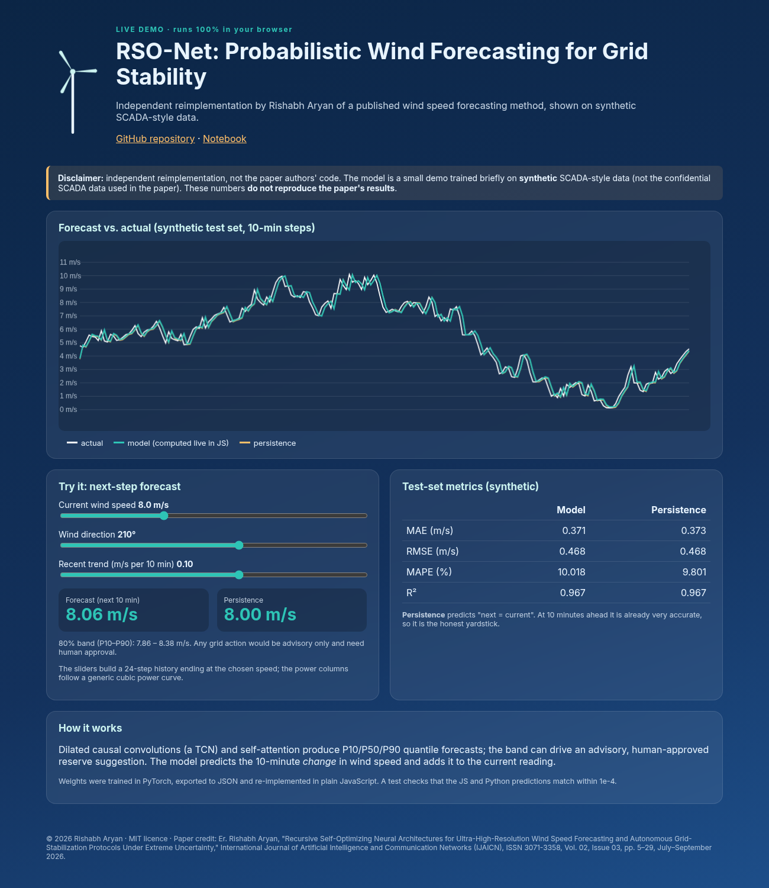

# RSO-Net: Recursive Self-Optimizing TCN-Attention Wind Speed Forecasting with Human-Approved Grid-Stabilization Proposals (Reimplementation)

[](https://rishabh-bgp.github.io/rso-net-wind-grid-stabilization/) [](https://colab.research.google.com/github/Rishabh-bgp/rso-net-wind-grid-stabilization/blob/main/notebooks/rso-net-wind-grid-stabilization_walkthrough.ipynb)

> **Independent reimplementation.** This repository is a clean, independent reimplementation of the method described in the
> paper cited below, written from the paper's text. It is **not** the original authors' code, and it does **not** use the
> paper's dataset. This model is fully classical and runs on CPU.
> Results from this code **will differ** from the published results, and the numbers reported in the paper have **not** been reproduced here.

**Keywords:** wind speed forecasting, temporal convolutional network, dilated causal convolution, self-attention, probabilistic forecasting, quantile regression, grid stabilization, human-in-the-loop, PyTorch

## Paper

Er. Rishabh Aryan, "Recursive Self-Optimizing Neural Architectures for Ultra-High-Resolution Wind Speed Forecasting and Autonomous Grid-Stabilization Protocols Under Extreme Uncertainty," *International Journal of Artificial Intelligence and Communication Networks (IJAICN)*, ISSN 3071-3358, Vol. 02, Issue 03, pp. 5–29, July–September 2026.

Full credit for the method goes to the paper's authors. Any simplifications or mistakes in this reimplementation are mine.

## Method

1. **RSO-Net forecaster:** stacked dilated causal convolutions (dilations 1, 2, 4, 8) followed by multi-head self-attention, with a **quantile head** (P10/P50/P90, monotone by construction) trained with pinball loss.
2. **Bounded self-optimisation:** after each adaptation window (epoch) a controller adjusts the learning rate within fixed bounds based on validation loss. Every change is logged to `results/controller_log.json`, and weights roll back to the best checkpoint if validation gets worse, so it's bounded, logged and reversible as the paper describes.
3. **Grid-stabilisation proposal:** the P10–P90 band is turned into an **advisory** spinning-reserve suggestion marked `PENDING_HUMAN_APPROVAL` with `auto_execute: false`. Nothing here acts on any real system.

The paper's six-agent orchestration (built on the OpenAI Agents SDK) and the frequency-response simulation are not included, since they would need an external API account.

## Architecture

```
x (B,T,5) → [CausalConv(d=1)→ReLU→…→CausalConv(d=8)→ReLU] → MultiHeadAttn → last step
  → Linear(→3) → cumulative softplus → (P10, P50, P90)
outer loop: val loss → BoundedController(lr ∈ [1e-4, 1e-2], rollback) 
P10–P90 band → advisory reserve proposal → human approval gate
```

## Data

The original SCADA data used in the paper is confidential and **not publicly available**, so it is not included here (everything in `data/` except the bundled synthetic CSV is git-ignored). The original code was not available either.
`src/data.py` provides:

- `load_scada_csv(path)`: loads a SCADA-style CSV with columns for timestamp, wind speed (m/s), wind direction (°),
  theoretical power and active power. It accepts both snake_case names (`timestamp, wind_speed, wind_direction,
  theoretical_power, active_power`) and the common Kaggle-style headers
  (`Date/Time, LV ActivePower (kW), Wind Speed (m/s), Theoretical_Power_Curve (KWh), Wind Direction (°)`).
- `synthetic_scada(n)`: an offline synthetic fallback (diurnal + weekly cycles, AR(1) turbulence, a cubic power curve and
  noisy active power). It is generated by script, so no download or account is needed:
  `python scripts/make_synthetic.py --n 3000`.

**Bundled synthetic dataset:** `data/synthetic/synthetic_scada.csv` (3000 rows, 10-minute steps, seed 0) is **synthetic data generated by `scripts/make_synthetic.py`**. It is **not** the confidential SCADA data used in the paper and has no connection to any real wind farm. `train.py` uses it by default. To use your own data locally, pass `--csv path/to/scada.csv`. Anything else you put in `data/` is git-ignored, so real data is never committed.

Features per time step are wind speed, sin/cos of direction, theoretical power and active power (kW/1000), standardised
on the training split. The target is wind speed `horizon` steps ahead. The data is split chronologically 70/15/15.

## How to run

```bash
python -m venv .venv && source .venv/bin/activate
pip install -r requirements.txt

# quick smoke test on the built-in synthetic data
python train.py --epochs 2

# full run on your own SCADA-style CSV
python train.py --csv path/to/scada.csv --epochs 40
```

The script prints and saves (`results/*_metrics.json`) **MAE, RMSE, MAPE and R²** on the chronological test split, plus a
naive persistence baseline for comparison. MAPE uses a 0.5 m/s floor in the denominator so calm periods don't blow it up.

## Smoke-test results (synthetic data only)

These come from a deliberately tiny run (2 adaptation windows, 3,000 synthetic rows, look-back 32, seed 42) on **synthetic data**, just to check that the pipeline works
end to end. They say nothing about the method's real accuracy. At this budget the model has not converged and is **worse than persistence**.

| Metric | Model | Persistence |
|---|---|---|
| MAE | 0.875 | 0.362 |
| RMSE | 1.113 | 0.449 |
| MAPE (%) | 21.227 | 7.654 |
| R² | 0.597 | 0.934 |

## Live demo

**[https://rishabh-bgp.github.io/rso-net-wind-grid-stabilization/](https://rishabh-bgp.github.io/rso-net-wind-grid-stabilization/)** runs entirely in your browser. A small version of the model (trained briefly on the bundled synthetic CSV to predict the 10-minute change in wind speed) is exported to JSON by `web/export_model.py`, and its forward pass is re-implemented in plain JavaScript (`site/model.js`). `tests/test_js_parity.py` checks that the JS and PyTorch predictions agree within 1e-4. The page shows a forecast chart against persistence, sliders for wind inputs, the metrics and the disclaimer.



## Notebook

[`notebooks/rso-net-wind-grid-stabilization_walkthrough.ipynb`](notebooks/rso-net-wind-grid-stabilization_walkthrough.ipynb) [](https://colab.research.google.com/github/Rishabh-bgp/rso-net-wind-grid-stabilization/blob/main/notebooks/rso-net-wind-grid-stabilization_walkthrough.ipynb) is a short, beginner-friendly walkthrough: load the synthetic CSV, quick EDA plots, a small version of the model, brief training and a comparison with a persistence baseline. It works when opened on its own in Colab (it fetches the repo code and data). It uses **synthetic data only** and does **not** reproduce the paper's results.

## Tests

```bash
pytest -q
```

## Repository layout

```
├── train.py              # train + evaluate (MAE/RMSE/MAPE/R²)
├── scripts/make_synthetic.py
├── src/
│   ├── data.py           # SCADA CSV loader, synthetic generator, windowing
│   ├── metrics.py
│   ├── train_common.py
│   └── rso_net.py
├── requirements.txt  LICENSE  .gitignore
```

## Limitations

- The paper targets sub-minute (30 s) data; the synthetic generator defaults to 10-minute steps (`freq` argument in `synthetic_scada`).
- ARIMA/LSTM baselines and the multi-agent system are not included; only a persistence baseline is reported.

## Licence

MIT © 2026 Rishabh Aryan. See [LICENSE](LICENSE). The paper itself remains under its publisher's terms.

## Other repositories by Rishabh Aryan

- [beed-ml-study](https://github.com/Rishabh-bgp/beed-ml-study)
- [pan-cancer-classification](https://github.com/Rishabh-bgp/pan-cancer-classification)
- [spam-scan](https://github.com/Rishabh-bgp/spam-scan)
- [real-estate-valuation-taiwan](https://github.com/Rishabh-bgp/real-estate-valuation-taiwan)
- [boston-house-price-prediction](https://github.com/Rishabh-bgp/boston-house-price-prediction)
- [california-house-price-prediction](https://github.com/Rishabh-bgp/california-house-price-prediction)
- [iris-classification](https://github.com/Rishabh-bgp/iris-classification)
- [machine-learning-part-1](https://github.com/Rishabh-bgp/machine-learning-part-1)
- [All repositories](https://github.com/Rishabh-bgp?tab=repositories)
